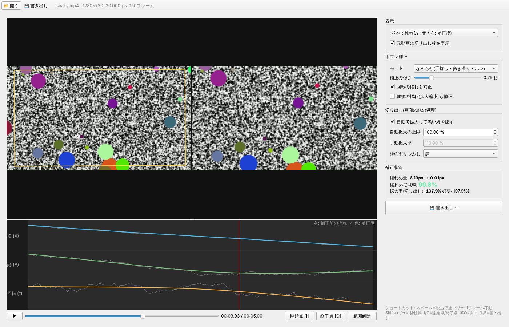

# 手ブレ補正アプリ(Mac 用)

ミラーレス一眼などで撮った動画の手ブレを補正するデスクトップアプリです。
補正前と補正後を**並べて見比べながら**補正の強さや切り出しを調整し、納得したら書き出せます。



## 主な機能

- **自動の手ブレ解析**: 動画を開くと、フレームごとのカメラの揺れ(上下・左右・回転)を自動で解析します
- **補正状況をリアルタイムで確認**
  - 並べて比較(左: 元の映像+切り出し枠 / 右: 補正後)、補正後のみ、元動画のみ を切り替えて表示
  - カメラの揺れのグラフ(灰色=補正前、色付き=補正後)。グラフをクリックするとその位置へ移動
  - 「揺れの低減率」と必要な拡大率を数値で表示
- **調整できる項目**
  - モード: なめらか(手持ち・歩き撮り・パン向け)/ 三脚固定(カメラを動かさない場面向け)
  - 補正の強さ(0.05〜3 秒): 大きいほどなめらかになるが、拡大(切り出し)も大きくなる
  - 回転の揺れ補正、前後の揺れ(拡大縮小)補正の ON/OFF
  - 自動拡大で黒い縁を隠す/手動の拡大率、縁の塗りつぶし方法
- **範囲を指定して書き出し**(開始点 I / 終了点 O)。**音声もそのまま残ります**
- 書き出し形式: H.264(MP4)、H.265/HEVC(MP4)、ProRes 422 HQ(MOV)、Mac のハードウェアエンコード(使える場合)

## インストールと起動

必要なもの: macOS(Apple シリコン/Intel)、Python 3.9 以上

1. このフォルダを Mac に置きます(例: `git clone` するか ZIP でダウンロードして展開)
2. Python が入っていなければ、ターミナルで次のどちらかを実行します
   ```bash
   xcode-select --install
   ```
   (または https://www.python.org/downloads/ からインストール)
3. **`run.command` をダブルクリック**します
   - 初回は必要なライブラリを自動でインストールするため数分かかります
   - 「開発元が未確認」と表示された場合は、右クリック →「開く」を選んでください
   - ダブルクリックで開けない場合はターミナルで次を実行します
     ```bash
     chmod +x run.command make_app.sh
     ```

アプリケーションとして Launchpad や Dock から起動したい場合は、セットアップ後にターミナルで実行します:
```bash
./make_app.sh
```
`~/Applications/手ブレ補正.app` が作られます。

## 使い方

1. 「開く」または動画をウィンドウにドラッグ&ドロップ → 自動で解析が始まります
2. スペースキーで再生し、左右を見比べながら補正の強さを調整します
   - 揺れが残る → 「補正の強さ」を上げる
   - 拡大されすぎる/縁が見える → 「補正の強さ」を下げる、または「回転の揺れも補正」を外す
   - 固定撮影の場面 → モードを「三脚固定」に
3. 必要なら開始点(I)・終了点(O)で書き出す範囲を決めます
4. 「書き出し」→ 形式と保存先を選ぶと書き出されます(元のファイルは変更されません)

| キー | 動作 |
|---|---|
| スペース | 再生 / 停止 |
| ← / → | 1 フレーム移動(Shift で 1 秒) |
| I / O | 開始点 / 終了点 |
| ⌘O / ⌘E | 開く / 書き出し |

## コマンドラインで使う

```bash
.venv/bin/python -m stabilizer --cli 入力.mp4 出力.mp4 --strength 1.0
```
オプション: `--tripod`(三脚固定)、`--no-rotation`、`--codec h264|hevc|prores|h264_vt|hevc_vt`

## しくみ

1. 各フレームで特徴点を検出し、オプティカルフローで次のフレームへの移動を追跡(OpenCV)
2. RANSAC で「カメラ全体の動き」(平行移動・回転・拡大率)を推定し、積算してカメラの軌跡を作成
3. 軌跡をガウシアンでなめらかにし、元の軌跡との差を各フレームに逆補正としてかける
4. 補正で画面の縁が見えないよう、必要最小限だけ拡大して切り出す
5. 元の解像度・フレームレートで ffmpeg に渡して書き出し、元の音声を合成

## 注意点・制限

- 書き出しは 8bit 処理です。10bit / Log で撮影した素材も 8bit に変換されます(ProRes で書き出しても階調は 8bit 相当)
- 補正の分だけ画面が拡大(切り出し)されるため、わずかに画角が狭くなり解像感が下がります
- ローリングシャッターによる「こんにゃく現象」や、ブレによるボケ(モーションブラー)は補正できません
- 画面の大部分を動く被写体が占める場面では、被写体の動きをカメラの揺れと誤認することがあります
- 長い動画はプレビュー用に縮小画像をメモリに保持します(10 分の 4K/60p で 1〜2GB 程度)
